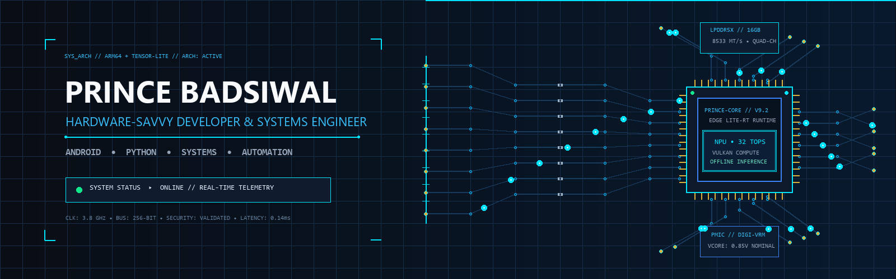

<picture>
  <source
    media="(prefers-reduced-motion: reduce)"
    srcset="./assets/hardware-signal-static.jpg"
  />
  
</picture>

 

`SYSTEM STATUS  ▸  ON-DEVICE AI • ANDROID • PYTHON SYSTEMS • ACTIVE`

  

---

## [01] SYSTEM OVERVIEW

I build **privacy-first, hardware-aware software** across on-device Android AI, resilient Python automation, and hybrid retrieval pipelines. My work focuses on running compute locally where practical, designing for real-world network and filesystem failures, and verifying AI outputs before they hit production.

- 📱 **On-Device & Edge AI:** Android systems built with Kotlin and Jetpack Compose, leveraging LiteRT, Vulkan GPU delegates, and real-time camera OCR.
- 🛡️ **Applied AI & Retrieval:** Hybrid search workflows (BM25 + dense embeddings) paired with prompt-injection defenses and structured evaluation.
- ⚙️ **Fault-Tolerant Automation:** Non-blocking media pipelines and reversible filesystem utilities engineered with dry-run previews and rollback manifests.

---

## [02] FEATURED SYSTEMS

> 🌟 **Flagship Project:** **[`Local-LLM-AI`](https://github.com/PrinceBad/Local-LLM-AI)**  
> An offline-first Android inference and camera OCR engine built to benchmark quantized LLM execution, memory pressure, and Vulkan GPU acceleration on real mobile hardware.

| System | Architectural Focus | Core Stack |
| :--- | :--- | :--- |
| **[`Local-LLM-AI`](https://github.com/PrinceBad/Local-LLM-AI)** | Offline Android LLM execution, hardware profiling, and camera OCR workflows with zero cloud dependence | `Kotlin` · `Compose` · `LiteRT` · `Vulkan` |
| **[`APEX-ATS`](https://github.com/PrinceBad/APEX-ATS)** | Hybrid resume retrieval engine combining lexical + semantic search with input-sanitization safeguards | `Python` · `BM25` · `Embeddings` · `React` |
| **[`PyStream-Downloader`](https://github.com/PrinceBad/PyStream-Downloader)** | Resilient, concurrent stream capture with exponential backoff and fragment recovery | `Python` · `Async I/O` · `HLS/DASH` |
| **[`TubeNotes`](https://github.com/PrinceBad/TubeNotes)** | Automated media-to-document pipeline that converts educational videos into searchable, vector-crisp PDFs | `Python` · `NLP` · `PDF Generation` |

<b>🧰 View Developer & Media Utilities (4 Repositories)</b>

 

| Utility | Capability |
| :--- | :--- |
| **[`PyFile-Organizer`](https://github.com/PrinceBad/PyFile-Organizer)** | Non-destructive directory automation with dry-run previews, operation logs, and JSON rollback manifests. |
| **[`Py-Image-Compressor`](https://github.com/PrinceBad/Py-Image-Compressor)** | Batch image compression and format conversion with perceptual quality controls. |
| **[`Anime-Recommender`](https://github.com/PrinceBad/Anime-Recommender)** | Gemini-powered content matching and structured recommendation workflow. |
| **[`Image-2-Pdf-Demo`](https://github.com/PrinceBad/Image-2-Pdf-Demo)** | Multi-image preprocessing and clean document compilation pipeline. |

---
